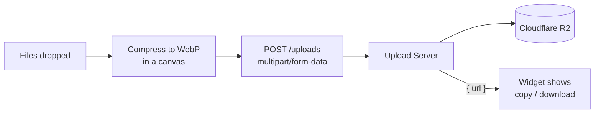

# Upload Widget

A React upload widget that compresses images in the browser before sending them to [Upload Server](https://github.com/thalessarubbi/upload-server). It shows per-file and overall progress, supports cancel and retry, and gives each uploaded image a public URL you can copy or download.

## Features

- **Drag-and-drop or click to select.** Accepts multiple JPEG, PNG and WebP images at once.
- **Client-side compression.** Each image is resized to a maximum of 1000×1000 px and re-encoded as WebP at 80% quality before upload. Each item shows the original size, the compressed size and the percentage saved.
- **Real-time progress.** Shows a progress bar for each file, plus an overall percentage in the header and a circular indicator in the dropzone.
- **Cancel and retry.** Cancel an upload while it's in progress. Retry any upload that failed or was cancelled.
- **Copy or download the result.** Copy an uploaded image's public URL to the clipboard, or download the compressed file.
- **Collapsible widget.** The widget collapses into a compact button. While uploads are running, that button shows an animated gradient border.

## How it works



1. `addUploads` gives each file an ID and adds it to a Zustand store, which holds a `Map` of uploads updated with Immer.
2. `compressImage` draws the image on a `<canvas>`, scales it to fit the size limit and exports it as a WebP `File`.
3. `uploadFileToStorage` sends the compressed file with Axios. As upload progress events arrive, it updates `uploadSizeInBytes` in the store.
4. When the request succeeds, the server responds with `{ url }`, which is saved as `remoteUrl`. Each upload has its own `AbortController`, so the upload can be cancelled.

### Upload states

| Status | Meaning | Available actions |
|---|---|---|
| `progress` | Compressing or uploading | Cancel |
| `success` | Stored on R2 and has a public URL | Copy URL, Download |
| `error` | Compression or upload failed | Retry |
| `cancelled` | Cancelled by the user | Retry |

## Tech Stack

| Layer | Technology |
|---|---|
| UI | React 18 + TypeScript |
| Build tool | Vite 6 |
| Styling | Tailwind CSS 3 + tailwind-variants |
| State | Zustand 5 + Immer |
| HTTP | Axios |
| Components | Radix UI (Collapsible, Progress, Scroll Area, Slot) |
| Animation | Motion |
| File input | react-dropzone |
| Icons | Lucide |
| Linting | ESLint 9 + typescript-eslint |
| Package manager | pnpm |

## Prerequisites

- Node.js 20+
- pnpm 10+
- [Upload Server](https://github.com/thalessarubbi/upload-server) running on `http://localhost:3333`
- A Cloudflare R2 bucket with a CORS policy (see [Configuration](#configuration))

## Getting Started

### 1. Clone and install dependencies

```bash
git clone git@github.com:thalessarubbi/upload-widget-web.git
cd upload-widget-web
pnpm install
```

### 2. Start the Upload Server

To set up the API, database and R2 credentials, follow the [Upload Server README](https://github.com/thalessarubbi/upload-server#getting-started).

### 3. Start the development server

```bash
pnpm dev
```

Open `http://localhost:5173` in your browser.

## Configuration

### API URL

The API URL is set in [`src/http/upload-file-to-storage.ts`](src/http/upload-file-to-storage.ts). The default is `http://localhost:3333/uploads`. To use a different server, change it there.

### R2 CORS policy

The **Download** button uses `fetch()` to get the image from R2, so the bucket must allow the widget's origin. In the Cloudflare dashboard, go to **R2 → your bucket → Settings → CORS Policy** and add:

```json
[
  {
    "AllowedOrigins": ["http://localhost:5173"],
    "AllowedMethods": ["GET"],
    "AllowedHeaders": ["*"]
  }
]
```

When you deploy the widget, add its production origin to `AllowedOrigins`.

### Compression settings

The compression settings are passed to `compressImage` in [`src/store/uploads.ts`](src/store/uploads.ts):

```ts
compressImage({ file, maxWidth: 1000, maxHeight: 1000, quality: 0.8 })
```

The server rejects files larger than 2 MB. This limit applies to the compressed file, not the original.

## Scripts

| Command | Description |
|---|---|
| `pnpm dev` | Start the Vite dev server with hot reload |
| `pnpm build` | Type-check and build for production into `dist/` |
| `pnpm preview` | Serve the production build locally |
| `pnpm lint` | Run ESLint |

## Project Structure

```
src/
├── components/
│   ├── ui/                          # Generic UI: Button, CircularProgressBar
│   ├── upload-widget.tsx            # Root: collapsible container and animations
│   ├── upload-widget-header.tsx     # Title bar with minimize control
│   ├── upload-widget-title.tsx      # "Uploading N%" / "Upload files"
│   ├── upload-widget-dropzone.tsx   # Drag-and-drop area
│   ├── upload-widget-upload-list.tsx
│   ├── upload-widget-upload-item.tsx  # One file: sizes, progress, actions
│   └── upload-widget-minimized-button.tsx
├── http/
│   └── upload-file-to-storage.ts    # Axios POST with progress and abort signal
├── store/
│   └── uploads.ts                   # Zustand store: upload lifecycle and global progress
├── utils/
│   ├── compress-image.ts            # Canvas-based resize and WebP conversion
│   ├── download-url.ts              # Fetch a remote file and save it
│   └── format-bytes.ts
├── app.tsx
└── main.tsx
```

## Troubleshooting

**Download fails with `No 'Access-Control-Allow-Origin' header`**
The R2 bucket has no CORS policy for your origin. To add one, see [R2 CORS policy](#r2-cors-policy). After adding it, hard-reload the page so the browser doesn't use a cached response.

**`pnpm install` fails with `ERR_PNPM_IGNORED_BUILDS`**
pnpm blocks dependency build scripts by default. `pnpm-workspace.yaml` already allows `esbuild`. If you see this error for another package, run `pnpm approve-builds`.

**Uploads end in `error` right away**
Check that Upload Server is running on port 3333 and that the file is JPEG, PNG or WebP. Other formats are rejected before upload.

## Acknowledgements

Built as part of the **Pós 360 Full-Stack** program at [Rocketseat](https://www.rocketseat.com.br).
